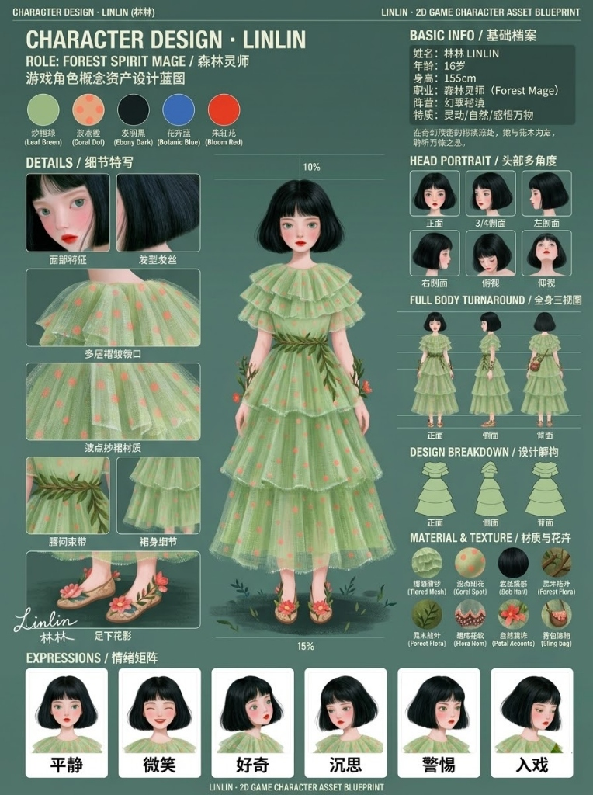
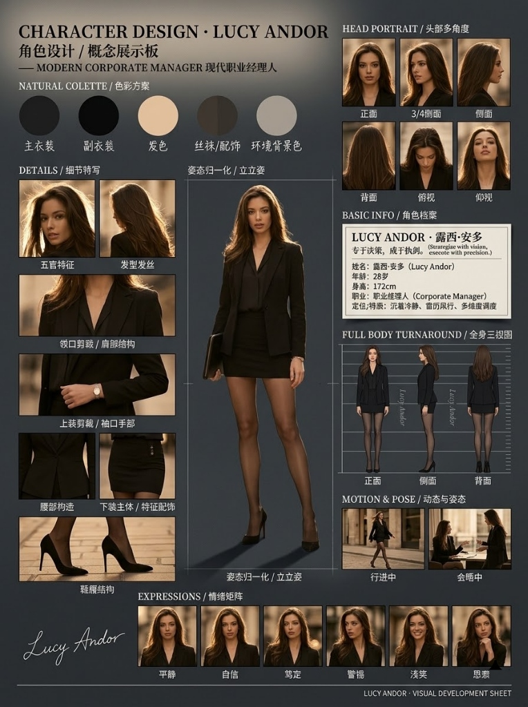
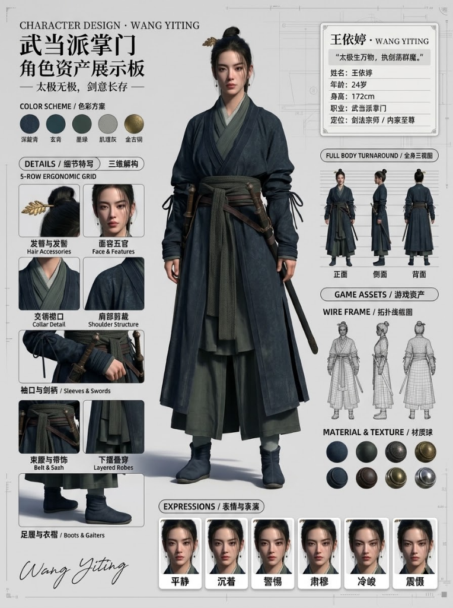
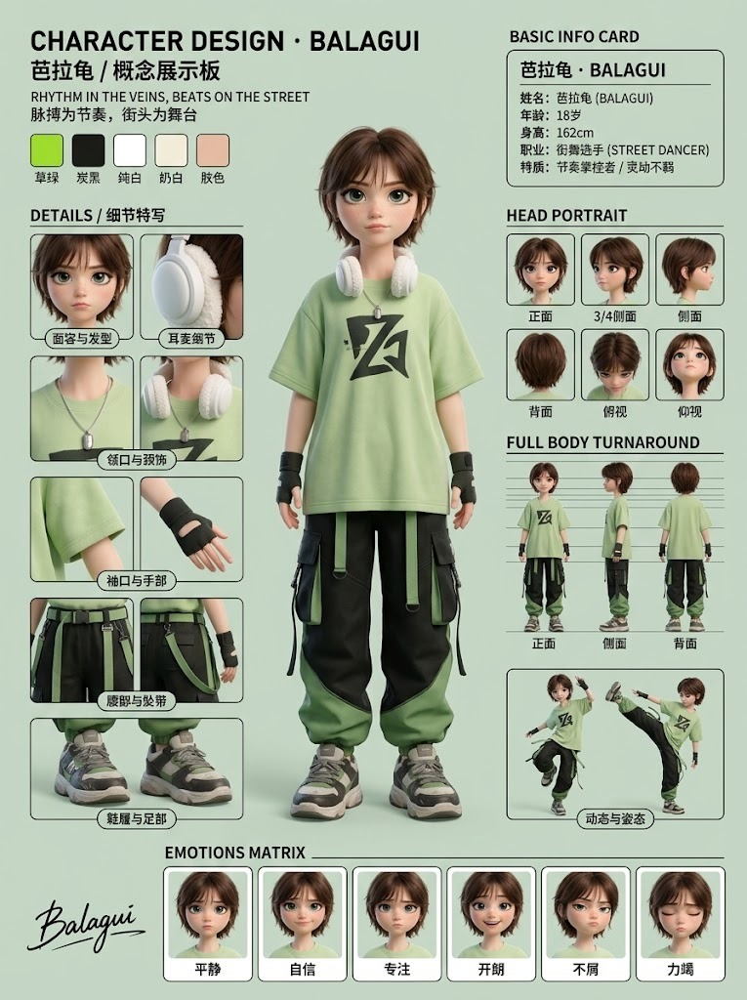
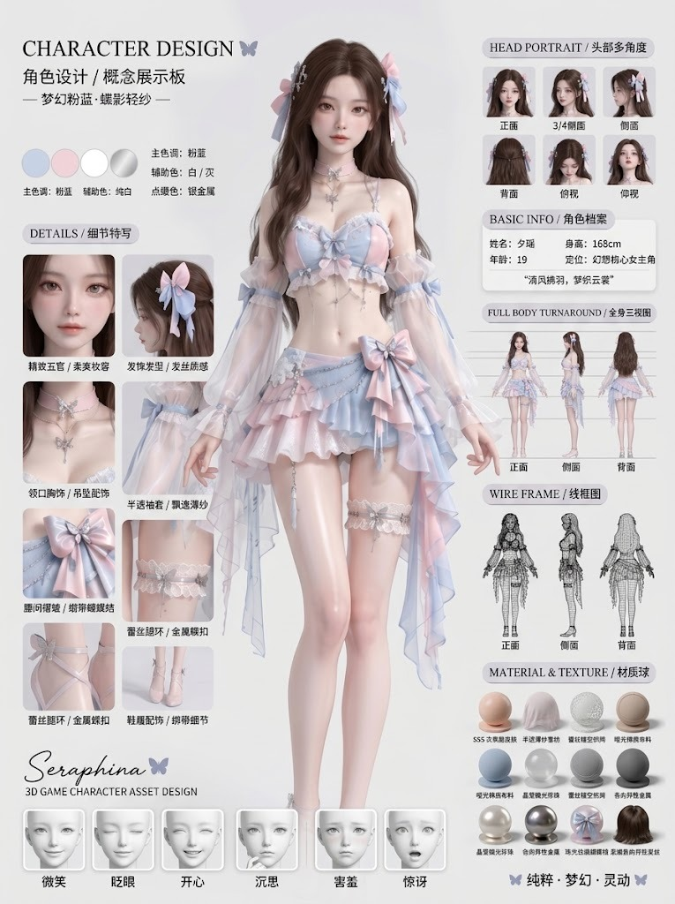
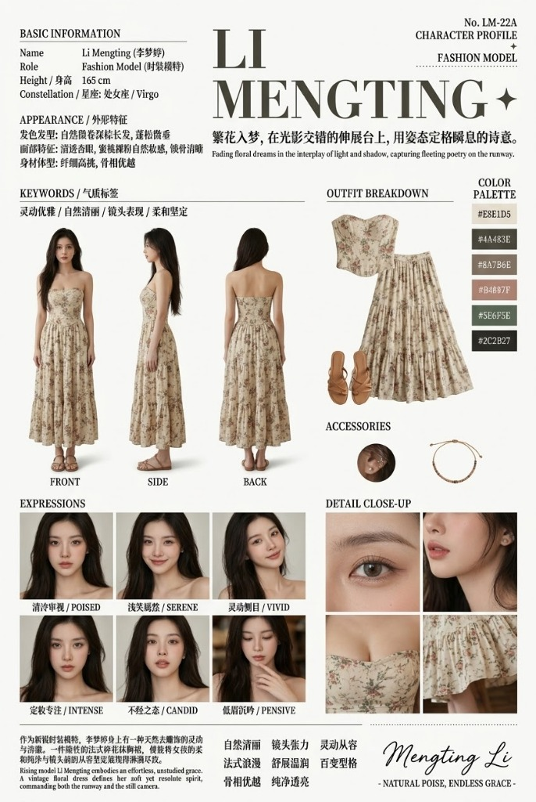
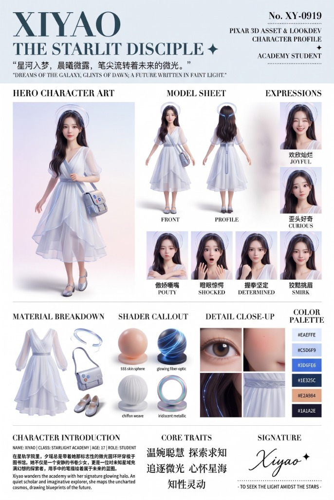

<div align="center">

# 🎭 Character-Skill
### Next-Gen Industrial Character Blueprint & Presentation Board Generator
**The Production-Grade 3:4 Model Sheet Standard for AI Image Diffusion & Visual Development**

[](LICENSE)
[](#layout-architecture)
[](#orthogonal-matrix-engine)
[](README_CN.md)

[English](README.md) · [简体中文](README_CN.md)

**Specifications**: [General Blueprint (ZH)](skill.md) · [General Blueprint (EN)](Skill-En.md) · [VisDev Bible (ZH)](visdev.md) · [VisDev Bible (EN)](visdev-En.md) · [Pixar 3D Asset (ZH)](pixar-3d-asset.md) · [Pixar 3D Asset (EN)](pixar-3d-asset-En.md) · [Skill Creator Engine](skill%20creator/Master-skill.md)

</div>

---

## 📖 Overview

**`character-skill`** is an open-source, production-grade AI Agent Skill that translates any character reference image, name, and role into a comprehensive **3:4 Vertical Character Blueprint Presentation Board** (Character Asset Sheet / VisDev Bible). 

Engineered for AAA game studios, animation houses, and concept artists, it standardizes character turnaround sheets across **FLUX, Midjourney v6, DALL-E 3, Stable Diffusion, and Gemini Imagen 3**.

### Why Character-Skill?
- 📐 **Industry-Standard 3:4 Aspect Ratio**: Abandons cramped 1:1 squares for elegant vertical artbook proportions (841×1024 / 768×1024), providing full vertical headroom and foot clearance for complete silhouettes.
- 🔄 **Omnidirectional Modality Invariance**: Strictly mirrors the input art style 1:1. Real photography stays photographic, 3D CG stays PBR-rendered, and 2D anime stays cel-shaded. Zero cross-style contamination.
- 🧩 **Orthogonal Domain Decoupling**: Separates rendering modality from industry domain. Supports **Film/Motion** (dynamic action poses, cloth physics) and **Game/Asset** (costumed quad-mesh topology, PBR material spheres).
- 🛡️ **5-Row Ergonomic Anti-Collision Grid**: An anatomical top-down layout container that completely eliminates text label overlapping and visual collision.
- 🔤 **Explicit Quoted UI Typography**: Injects legible Chinese & English bilingual pill badges, multi-angle head views, turnaround labels, and 6-expression performance strips.
- 🔒 **Two-Turn Execution Gate**: Enforces a strict two-stage workflow where prompts are previewed and confirmed before any image generation tools are triggered.

---

## 🖼️ Visual Showcase Gallery

`character-skill` adapts dynamically across all visual modalities and industry scenarios without manual tuning.

### 1. 2D Anime / Manga Illustration (`Game Asset Branch`)
> **Subject**: Linlin (林林) · Forest Spirit Mage (森林灵师)  
> **Key Features**: Tiered mint-green mesh gown, 5-row detail zoom-ins, 6 head angles, 3-view turnaround, garment silhouette breakdown, floral materials, and emotional expression strip.

<div align="center">
  
</div>

---

### 2. Real Photography / Cinematic VisDev (`Film & Motion Branch`)
> **Subject**: Lucy Andor (露西·安多) · Modern Corporate Manager (现代职业经理人)  
> **Key Features**: Authentic 35mm optical lens rendering, visible skin pores, natural key lighting, tailored black blazer, 6 head angles, turnaround with height gauge, and dynamic motion storyboards (walking, boardroom meeting).

<div align="center">
  
</div>

---

### 3. AAA Next-Gen 3D CG (`Game Asset Branch`)
> **Subject**: Wang Yiting (王依婷) · Wudang Grandmaster (武当派掌门)  
> **Key Features**: Next-gen PBR shaders, subsurface scattering, authentic Daoist martial robes, twin sheath blades, full costumed topology quad-mesh wireframe, 8 PBR material spheres, and full-color combat expressions.

<div align="center">
  
</div>

---

### 4. 3D Stylized Animation (`Film & Motion Branch`)
> **Subject**: Balagui (芭拉龟) · Street Dancer (街舞选手)  
> **Key Features**: High-end feature animation style (Pixar/DreamWorks aesthetic), oversized headphones, cargo joggers, 5-row street fashion callouts, turnaround, dynamic dance poses, and 6 micro-emotions.

<div align="center">
  
</div>

---

### 5. High-Aesthetic Benchmark Reference Sheet
> **Subject**: Seraphina (夕瑶) · Fantasy Visual Development  
> **Key Features**: Romantic pastel color palette, pill badges, intricate jewelry details, turnaround with reference lines, wireframe mesh, and 12 PBR material spheres.

<div align="center">
  
</div>

---

### 6. Film Visual Development & Costume Design Bible (`Film & Fashion VisDev Branch`)
> **Subject**: Li Mengting (李梦婷) · Fashion Model (时装模特)  
> **Specification**: [visdev.md](visdev.md) (ZH) · [visdev-En.md](visdev-En.md) (EN)  
> **Key Features**: 2:3 vertical golden aspect ratio, Didot two-line theme header, 9-head full-body turnaround (`FRONT`, `SIDE`, `BACK`), 6-expression photographic performance matrix, haute couture floral corset & skirt flat-lay deconstruction, floating ear cuff & bracelet accessories, 2x2 optical macro close-up grid, and 6-tone industrial HEX palette with cursive signature.

<div align="center">
  
</div>

---

### 7. Hollywood 3D Pixar Animation Character Asset & LookDev Sheet (`Feature Animation LookDev Branch`)
> **Subject**: Xiyao (夕瑶) · Academy Student (星轨学院学员)  
> **Specification**: [pixar-3d-asset.md](pixar-3d-asset.md) (ZH) · [pixar-3d-asset-En.md](pixar-3d-asset-En.md) (EN)  
> **Key Features**: 2:3 vertical golden aspect ratio, 40% dominant full-body hero master appeal pose, full-color orthographic turnaround model sheet, exaggerated 6-expression Pixar Squash-and-Stretch matrix, tactile chiffon dress & starlit halo breakdown, 4 PBR shader preview spheres (SSS skin, fiber-optic, chiffon, metallic), 2x2 macro grid, and industrial HEX palette with cursive signature.

<div align="center">
  
</div>

---

## 📐 Layout Architecture

The canvas strictly enforces a 3:4 vertical blueprint hierarchy, geometrically balanced to prevent overcrowding and label collisions:

```
+-----------------------------------------------------------------------------------+
| [Left 24%: Palette & Details]  | [Center 36%: Normalized Hero] | [Right 40%: Engineering & Specs] |
| - Primary title & thematic tag | - Golden-ratio center subject | - Head 6-Angle Array (2x3 grid)  |
| - 5 Physical color swatches    | - 【Pose Normalization】:      | - Key-Value Character Info Card  |
| - 7 Detail Callouts in 5 Rows: |   Relaxed Standing A-Pose     | - Full-Body 3-View Turnaround    |
|   Row 1: Face + Hair           |   revealing complete costume  | - Domain Module (Select One):    |
|   Row 2: Collar / Neckwear     | - 10% headroom, 15% footroom  |   * Film: Dynamic Motion Poses   |
|   Row 3: Torso / Sleeves       | - Soft ground contact shadow  |   * Game: Topology + PBR Spheres |
|   Row 4: Waist / Lower attire  |                               |                                  |
|   Row 5: Footwear (anchored)   |                               |                                  |
| - Single-source cursive sign   |                               |                                  |
+-----------------------------------------------------------------------------------+
| [Bottom 15%: Performance Strip] 6-expression horizontal strip (white cards + centered labels + full color) |
+-----------------------------------------------------------------------------------+
```

---

## ⚙️ Orthogonal Matrix Engine

`character-skill` synthesizes prompts along two decoupled dimensions:

```
                          ┌─► Film & Motion Branch (Default) ────► [Motion Poses + Cloth Aerodynamics]
[Input Character] ──Decouple──┤
                          └─► Game & Asset Branch (Explicit) ────► [Costumed Topology Mesh + Material Spheres]
       ▲
       │ (100% determined by reference image physical features)
       ├─► Modality A: Real Photography ──► [Optical lens fidelity, pores, studio key light; excludes 3D/Anime terms]
       ├─► Modality B: Next-Gen 3D CG   ──► [PBR shaders, subsurface scattering, ambient occlusion; excludes photo/line-art]
       └─► Modality C: 2D Anime/Manga   ──► [Crisp line-art, exquisite cel-shading; excludes 3D/photorealistic terms]
```

### Pure Positive Affirmation Rule
Modern diffusion models (FLUX, Midjourney, DALL-E 3) do not have negative prompt channels. Including words like `No 3D, without anime` triggers the **Pink Elephant Effect**, forcing the model to generate the forbidden elements. `character-skill` enforces **pure positive affirmation**, isolating vocabulary cleanly without negative phrases.

---

## 🏭 Skill Creator — The Meta-Skill Architecture (The Machine that Makes the Machine)

Beyond ready-to-use presentation board skills, this repository includes **`skill creator/`**, an industrial meta-skill manufacturing pipeline engineered to automatically assemble, stamp, and quality-audit brand-new domain-specific presentation board skills (e.g., Sci-Fi Mecha, Creature & Monsters, Cyberpunk Gear, Anime Model Sheets, Luxury Fashion):

| Component File | Role & Engineering Mission |
| :--- | :--- |
| **[`Master-skill.md`](skill%20creator/Master-skill.md)** | **The Meta-Skill Master Engine**: 5-step automated SOP assembly line that ingests domain requirements and outputs 100% self-contained, zero-dependency `.md` skill files. |
| **[`Rule.md`](skill%20creator/Rule.md)** | **Underlying Constitution**: Global invariants including default 2:3 golden ratio, 40% dominant hero anchor, pure positive affirmation, and two-turn execution gates. |
| **[`4-Pillar Architecture.md`](skill%20creator/4-Pillar%20Architecture.md)** | **Engineering Blueprint**: 4-Pillar model uniting Spatial Skeleton, Reverse-Engineering Decompiler, Dual-Track Prompt Compiler, and Two-Turn State Machine. |
| **[`base-text.md`](skill%20creator/base-text.md)** | **Typography Standard**: Mandatory Typography Triad (Didot Serif, tracked lore, dip-pen script), theme color extraction, and anti-glitch string injection. |
| **[`Benchmark.md`](skill%20creator/Benchmark.md)** | **Quality Control Matrix**: 10-point quantitative inline acceptance checklist and hard blocking gates for automated virtual QA inspection. |

---

## 🚀 Quick Start

### 1. Integrate with AI Agents
Download `skill.md` (or `Skill-En.md`) and drop it into your agent system:
- **Antigravity / Gemini CLI**: Place in `<workspace>/skills/character-skill/SKILL.md`
- **Claude Desktop / Claude Code**: Add to your MCP custom prompts or project instructions
- **ChatGPT / Custom GPTs**: Paste the contents of `Skill-En.md` into the GPT Instructions

### 2. User Input Protocol
Provide only **three core inputs**:
```text
1. Character Reference Image (PNG/JPG)
2. Character Name: Wang Yiting (王依婷)
3. Character Role: Wudang Grandmaster (武当派掌门)
(Optional: Application scene. Defaults to Film & Motion if omitted.)
```

### 3. Two-Turn Execution Flow
```text
Turn 1: The agent checks inputs, extracts features, and outputs:
        - Track A: One-Shot Bilingual Integrated Board (Full typography)
        - Track B: Clean Plate Without Typography (For manual PS/Figma editing)
        * The agent halts and waits for your confirmation.

Turn 2: You reply "生成图片" (Generate Image) or "直接出图" (Render Now).
        * The agent invokes the image generation tool and renders your board.
```

---

## 🛠️ Prompt Injection Standard

To render pristine Chinese characters on modern diffusion models, every on-screen label is wrapped in **explicit single quotes**:

```text
- Head Portrait: 2x3 grid labeled: '正面', '3/4侧面', '侧面', '背面', '俯视', '仰视'.
- Turnaround Views: Aligned full-body turnaround labeled: '正面', '侧面', '背面'.
- Expression Strip: 6 cards labeled: '平静', '沉着', '警惕', '肃穆', '冷峻', '震慑'.
- Detail Callouts: Pill badge: 'DETAILS / 细节特写', labeled: '领口颈饰', '上装剪裁'.
```

---

## 📂 Repository Structure

```
character-skill/
├── assets/                     # High-resolution showcase artwork
│   ├── 01_linlin_2d_anime.jpg
│   ├── 02_lucy_andor_real_photo.jpg
│   ├── 03_wang_yiting_3d_game.png
│   ├── 04_balagui_3d_stylized.jpg
│   ├── 05_seraphina_benchmark.jpg
│   ├── 06_li_mengting_visdev.jpg
│   └── 07_xiyao_pixar_3d_asset.jpg
├── skill.md                    # Core Blueprint Specification (Chinese)
├── Skill-En.md                 # Core Blueprint Specification (English)
├── visdev.md                   # Film VisDev & Costume Bible Specification (Chinese)
├── visdev-En.md                # Film VisDev & Costume Bible Specification (English)
├── pixar-3d-asset.md           # 3D Pixar Character Asset Specification (Chinese)
├── pixar-3d-asset-En.md        # 3D Pixar Character Asset Specification (English)
├── skill creator/              # Meta-skill manufacturing pipeline
│   ├── Master-skill.md         # Super master-skill assembly engine
│   ├── Rule.md                 # Underlying constitution & global invariants
│   ├── 4-Pillar Architecture.md# Engineering blueprint & 4-pillar model
│   ├── base-text.md            # Typography triad & UI text specifications
│   └── Benchmark.md            # Quality control matrix & acceptance gates
├── README.md                   # English Documentation
└── README_CN.md                # Chinese Documentation
```

---

## 📄 License

Distributed under the [MIT License](LICENSE). Free for personal, commercial, and research use.
Contributions and Pull Requests are welcome!
