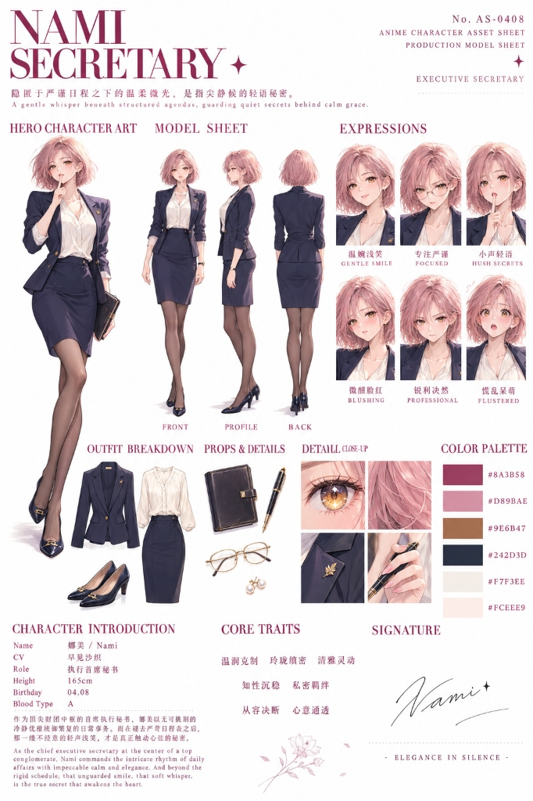

<div align="center">

# 🎭 Character-Skill
### 新一代工业级角色概念资产展示板设计引擎
**专为 AI 图像扩散模型与概念设计量身定制的 3:4 纵向全景设定集标准**

[](LICENSE)
[](#布局拓扑架构)
[](#两维正交矩阵引擎)
[](README.md)

[简体中文](README_CN.md) · [English](README.md)

**全套规范**: [通用角色蓝图 (中)](skill.md) · [通用角色蓝图 (英)](Skill-En.md) · [影视服化道圣经 (中)](visdev.md) · [影视服化道圣经 (英)](visdev-En.md) · [3D皮克斯动画资产 (中)](pixar-3d-asset.md) · [3D皮克斯动画资产 (英)](pixar-3d-asset-En.md) · [日本动漫角色资产 (中)](anime-character-asset.md) · [日本动漫角色资产 (英)](anime-character-asset-En.md) · [超级母机生产线](skill%20creator/Master-skill.md)

</div>

---

## 📖 项目简介

**`character-skill`** 是一套开源、面向顶级概念设计与游戏/影视工业资产标准打造的 AI Agent 角色设定集生成 Skill。

只需提供**角色参考图**、**角色名称**与**职业设定**，即可通过本 Skill 自动推演并生成符合 3A 工业级标准的 **3:4 竖版中英双语角色概念展示板（Character Presentation Board / Character Blueprint Sheet）**。

完美适配 **FLUX, Midjourney v6, DALL-E 3, Stable Diffusion, 以及 Google Gemini Imagen 3** 等现代主流文生图底座。

### 为什么选择 Character-Skill？
- 📐 **3:4 黄金竖版比例**：彻底摒弃拥挤局促的 1:1 方形构图，采用专业美术设定集标准的 3:4 竖版（841×1024 / 768×1024），为九头身角色立绘提供完整的头顶留白与足底悬空空间。
- 🔄 **模态全向对称守恒**：输入画风与输出画风严格 1:1 保持全同。真人摄影绝不变成 3D 动漫，3D CG 绝不变成扁平插画，二次元动漫绝不变成写实模型。
- 🧩 **两维正交矩阵解耦**：将“渲染画风”与“应用场景”彻底解耦。支持**影视/动态分支**（动作走位、风阻与镜头标记）与**游戏/资产分支**（原装真身四边面网格拓扑、8~12 组 PBR 材质球）。
- 🛡️ **人体工学 5 行错落防撞栅格**：自顶向下的人体与服装层级解构容器，从几何空间上彻底根除文字标签与特写图片的重叠粘连。
- 🔤 **汉字单引号硬注入标准**：所有需要在画面中渲染呈现的中英文界面文本（胶囊徽章、三视图标签、6 视角肖像、6 联微表情）均通过显式单引号声明，杜绝扩散模型生成乱码。
- 🔒 **两轮标准化交互门禁**：首轮输出完整提示词源码供用户预览审查，绝不抢跑出图；用户确认后方才在第二轮启动生图工具。

---

## 🖼️ 工业视觉展示廊 (Showcase)

`character-skill` 具备极强的泛化能力，覆盖各类画风题材与行业场景：

### 1. 二次元动漫手绘 (`游戏资产分支`)
> **角色**: 林林 (LINLIN) · 森林灵师 (Forest Spirit Mage)  
> **核心特性**: 薄荷绿层叠多尼褶皱波点纱裙、左侧 5 行错落特写、头部 6 视角、全身三视图、裙身设计解构图、材质与花卉取样、底栏 6 联微表情矩阵。

<div align="center">
  
</div>

---

### 2. 真实人像摄影 / 影视概念视效 (`影视/动态分支`)
> **角色**: 露西·安多 (Lucy Andor) · 现代职业经理人 (Modern Corporate Manager)  
> **核心特性**: 纯正 35mm 人像镜头光学散景、真实皮肤细腻毛孔、定制黑色西装、头部 6 视角、带等高尺全身三视图、右下影视分镜动态走位模块（行进中、会晤中）、底栏写实微表情。

<div align="center">
  
</div>

---

### 3. 次世代 3A 3D 游戏资产 (`游戏资产分支`)
> **角色**: 王依婷 (Wang Yiting) · 武当派掌门 (Wudang Grandmaster)  
> **核心特性**: 次表面散射 (SSS) 皮肤着色器、交领道袍重工布料物理、双剑剑柄与袖口细节、**身穿完整服装的 3 视角四边面网格拓扑 (Topology Quad-Mesh)**、8 组独立 3D PBR 材质球、全彩战斗情绪矩阵。

<div align="center">
  
</div>

---

### 4. 3D 风格化美式动画 (`影视/动态分支`)
> **角色**: 芭拉龟 (Balagui) · 街舞选手 (Street Dancer)  
> **核心特性**: 皮克斯/梦工厂顶级风格化 3D 质感、头戴式耳机、潮流工装束脚裤、潮鞋与足部细节、全身三视图、右下街舞动态飞踢与律动走位、6 联元气微表情。

<div align="center">
  
</div>

---

### 5. 浪漫唯美标杆范式展示板
> **角色**: 夕瑶 (Seraphina) · 唯美幻想概念设定  
> **核心特性**: 柔和马卡龙色板、胶囊徽章 UI、蝴蝶吊坠与蕾丝细节、对齐标线三视图、服装拓扑线框、12 组水晶与丝绸材质球。

<div align="center">
  
</div>

---

### 6. 国际顶级影视视觉开发与剧组服化道圣经 (`影视概念与高奢服化道分支`)
> **角色**: 李梦婷 (Li Mengting) · 时装模特 (Fashion Model)  
> **核心规范**: [visdev.md](visdev.md) (中文) · [visdev-En.md](visdev-En.md) (英文)  
> **核心特性**: 2:3 纵向黄金画幅、Didot 双行主题色巨标、九头身全身正/侧/背定妆三视图、6 联全彩演艺微表情摄影肖像、法式碎花抹胸裙与褶皱裙立体平铺解构(Flat-lay)、独立耳骨夹与手链悬浮展台、无编号 2×2 光学微距四宫格、工业 6 色 HEX 色卡与艺术小传手写签名。

<div align="center">
  
</div>

---

### 7. 好莱坞顶级 3D 皮克斯动画角色资产与 LookDev 模型板 (`长片动画视效与资产分支`)
> **角色**: 夕瑶 (Xiyao) · 星轨学院学员 (Academy Student)  
> **核心规范**: [pixar-3d-asset.md](pixar-3d-asset.md) (中文) · [pixar-3d-asset-En.md](pixar-3d-asset-En.md) (英文)  
> **核心特性**: 2:3 纵向黄金画幅、40% 统治级主体全身大立绘(Hero Shot)、全彩正交转台三视图（正/侧/背）、皮克斯长片标志性 Squash-and-Stretch 夸张生动六联表情矩阵、星轨校服薄纱裙与微光圆环材质拆解、4 组次表面着色器材质球(SSS皮肤/光纤/雪纺/金属)、2×2 微距四宫格与纯 HEX 色卡系统。

<div align="center">
  
</div>

---

### 8. 日本顶级动漫角色资产与设定资料集模型板 (`长片动画与番剧设定集分支`)
> **角色**: 娜美 (Nami) · 执行首席秘书 (Executive Secretary)  
> **核心规范**: [anime-character-asset.md](anime-character-asset.md) (中文) · [anime-character-asset-En.md](anime-character-asset-En.md) (英文)  
> **核心特性**: 2:3 纵向黄金画幅、40% 统治级主体全身大立绘(Hero Shot)、全彩正交转台三视图（正/侧/背）、京都动画/MAPPA 级别灵动赛璐珞光影与星芒眼眸、6 联生动日漫微表情矩阵、修身西装制服与铅笔裙平铺拆解、真皮手账与金丝眼镜配件展台、2×2 视效微距四宫格与纯 HEX 色卡系统。

<div align="center">
  
</div>

---

## 📐 布局拓扑架构

画布严格采用 3:4 竖版空间网格，按空间力学进行黄金分割，确保信息密度与呼吸感平衡：

```
+-----------------------------------------------------------------------------------+
| [左栏 24%: 视觉取样与局部层级] | [中栏 36%: 姿态归一化立绘]   | [右栏 40%: 工程规格与解构中心] |
| - 主副双语标题与设计标语       | - 黄金比例绝对中心立绘       | - 头部 6 视角阵列 (2x3 矩阵)   |
| - 5色真实材质物理取样色板      | - 【姿态归一化】：标准直立   | - 结构化 Key-Value 角色档案卡  |
| - 7组【5行防撞错落特写栅格】:  |   A-Pose/松弛站姿，完全展现  | - 全身三视图 (带水平对齐标线)  |
|   Row 1: 五官面容 + 发型发丝   |   整体服装剪裁与廓形         | - 正交场景专属模块 (二选一):   |
|   Row 2: 领口颈饰 / 肩部结构   | - 头顶留白10%、脚跟留白15%   |   * 默认影视: 走位动态与风阻   |
|   Row 3: 上装剪裁 / 袖口手部   | - 地面真实物理接触投影       |   * 游戏分支: 原装拓扑+材质球  |
|   Row 4: 腰部构造 / 下装主体   |                               |                                |
|   Row 5: 鞋履构造 (沉底独立)   |                               |                                |
| - 底部同源艺术手写签名         |                               |                                |
+-----------------------------------------------------------------------------------+
| [底栏 15%: 情绪与表演全宽通栏] 6 联横跨微表情 (白底卡片 + 居中加粗汉字命名 + 全板同质全彩渲染)  |
+-----------------------------------------------------------------------------------+
```

---

## ⚙️ 两维正交矩阵引擎

Prompt 体系由 **渲染画风** 与 **行业应用场景** 两维正交笛卡尔积派生：

```
                    ┌─► 影视/动态工程分支 (Film & Motion - 默认) ──► [动态走位 + 风阻布料物理]
[输入角色] ──正交解耦──┤
                    └─► 游戏/资产工程分支 (Game & Asset - 显式指定) ──► [原装拓扑线框 + 材质球解构]
       ▲
       │ (100% 由参考图物理特征唯一决定)
       ├─► 模态 A: 真实人像摄影 (Real Photography) ──► [光学镜头微距毛孔，排斥 3D/CG/二次元术语]
       ├─► 模态 B: 次世代 3D 渲染 (Next-Gen 3D CG)  ──► [次表面散射与 PBR，排斥实拍写真/二次元线稿]
       └─► 模态 C: 二次元动漫手绘 (2D Anime/Manga)   ──► [赛璐珞平涂与线条感，排斥 3D/实拍词汇]
```

### 静默纯正向词法（Pure Positive Affirmation）
现代扩散模型没有负向词通道。如果在提示词中写 `No 3D, without CG, no anime`，会直接触发**“粉象效应”**，导致模型反向生成不需要的元素。`character-skill` 严格执行纯正向词法，仅通过目标模态的硬核专业词汇构建环境，绝口不提非目标模态的词根。

---

## 🏭 Skill Creator — 展示板技能超级母机与元架构流水线 (The Machine that Makes the Machine)

除了开箱即用的成品展示板技能外，本项目核心工程库包含 **`skill creator/`** 工业级元架构生产流水线。它是一套用于自动化组装、冲压、质检全新垂直领域展示板技能的“超级母机”，面向任意新题材（如科幻机甲、奇幻生物、赛博朋克装备、日漫立绘、高奢时尚等），一键交付 100% 自包含、零外部依赖的全新独立 `.md` 技能：

| 构件文件 | 角色与工程使命 |
| :--- | :--- |
| **[`Master-skill.md`](skill%20creator/Master-skill.md)** | **展示板超级母机技能 (Meta-Skill)**：总调度与 5 步 SOP 冲压流水线，自动将底层宪法与工程图纸内联熔铸为全新领域的独立技能。 |
| **[`Rule.md`](skill%20creator/Rule.md)** | **底层宪法与全局公理**：规定默认 2:3 纵向黄金画幅、40% 主体大立绘统治位、纯正向反粉象词法、两轮状态机等绝对不变量。 |
| **[`4-Pillar Architecture.md`](skill%20creator/4-Pillar%20Architecture.md)** | **四位一体工程模型**：统合物理空间骨架、视觉特征语义反编译器、双轨提示词编译器（整板+纯底板）及两轮执行协议。 |
| **[`base-text.md`](skill%20creator/base-text.md)** | **字体排版与文字规范**：确立 Didot 大标、通透正文、蘸水笔花体签名之“字体三件套”，规范服饰主题色提取与单引号注入契约。 |
| **[`Benchmark.md`](skill%20creator/Benchmark.md)** | **质检矩阵与验收阻断线**：提供 10 大核心指标量化自检清单与一票否决门禁，保障流水线出厂质量零缺陷。 |

---

## 🚀 快速上手

### 1. 接入 AI 智能体 (Agent)
直接下载 `skill.md`（或 `Skill-En.md`）配置进你的智能体环境：
- **Antigravity / Gemini CLI**：放置在 `<workspace>/skills/character-skill/SKILL.md`
- **Claude Desktop / Claude Code**：直接引入为自定义 Project Instructions 或 System Prompt
- **ChatGPT / Custom GPTs**：将 `skill.md` 内容直接粘贴至 GPT 的 Instructions 即可

### 2. 用户交互协议
用户仅需提供**三项核心要素**：
```text
1. 角色参考图 (PNG/JPG)
2. 角色名称：王依婷
3. 角色职业：武当派掌门
（可选：应用场景。未指定时默认按影视/动态分支生成）
```

### 3. 两轮交互流程
```text
第 1 轮：Agent 检查输入要素，推演视觉特征，在 Markdown 代码块中交付：
        - 方案 A：一键整板中英双语生成（完整排版）
        - 方案 B：纯净无文字底图生成（供 PS/Figma 自行填字）
        * Agent 在此轮物理等待，绝对不调用任何生图工具。

第 2 轮：用户在确认提示词后，回复：“生成图片” 或 “直接出图”。
        * Agent 启动生图工具并生成最终展示板画作。
```

---

## 🛠️ 汉字单引号硬注入标准

为确保现代扩散模型精准渲染中文字形与排版，提示词中所有界面文本必须以**单引号严格包裹**：

```text
- 头部多角度: 2x3 grid labeled: '正面', '3/4侧面', '侧面', '背面', '俯视', '仰视'.
- 全身三视图: Full-body turnaround labeled: '正面', '侧面', '背面'.
- 微表情矩阵: 6 cards labeled: '平静', '沉着', '警惕', '肃穆', '冷峻', '震慑'.
- 细节特写栏: Pill badge: 'DETAILS / 细节特写', labeled: '领口颈饰', '上装剪裁'.
```

---

## 📂 项目文件结构

```
character-skill/
├── assets/                     # 高清工业示例画作
│   ├── 01_linlin_2d_anime.jpg
│   ├── 02_lucy_andor_real_photo.jpg
│   ├── 03_wang_yiting_3d_game.png
│   ├── 04_balagui_3d_stylized.jpg
│   ├── 05_seraphina_benchmark.jpg
│   ├── 06_li_mengting_visdev.jpg
│   ├── 07_xiyao_pixar_3d_asset.jpg
│   └── 08_nami_anime_character_asset.jpg
├── skill.md                    # 通用角色蓝图规范源码 (中文版)
├── Skill-En.md                 # 通用角色蓝图规范源码 (英文版)
├── visdev.md                   # 影视服化道圣经规范源码 (中文版)
├── visdev-En.md                # 影视服化道圣经规范源码 (英文版)
├── pixar-3d-asset.md           # 3D皮克斯动画资产规范源码 (中文版)
├── pixar-3d-asset-En.md        # 3D皮克斯动画资产规范源码 (英文版)
├── anime-character-asset.md    # 日本顶级动漫角色资产规范源码 (中文版)
├── anime-character-asset-En.md # 日本顶级动漫角色资产规范源码 (英文版)
├── skill creator/              # 展示板母机元架构流水线源码
│   ├── Master-skill.md         # 超级母机总调度与冲压引擎
│   ├── Rule.md                 # 底层宪法与全局公理
│   ├── 4-Pillar Architecture.md# 四位一体工程模型设计蓝图
│   ├── base-text.md            # 字体三件套与界面文字规范
│   └── Benchmark.md            # 质检矩阵与出厂验收清单
├── README.md                   # 英文说明文档
└── README_CN.md                # 中文说明文档
```

---

## 📄 开源许可证

本项目基于 [MIT 许可证](LICENSE) 开源。欢迎用于个人学习、商业项目及学术研究。
欢迎提交 Issue 与 Pull Request！
